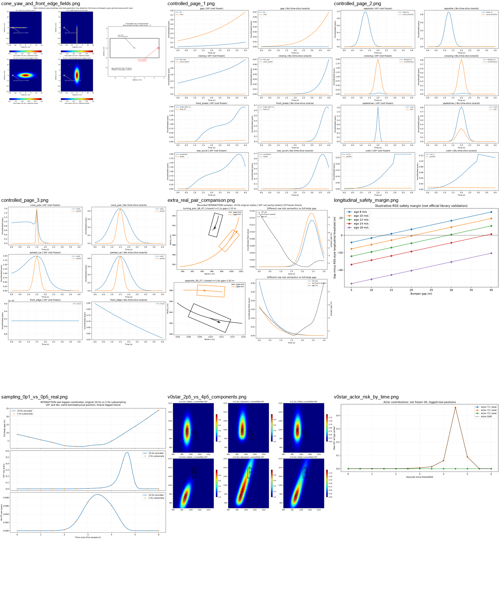
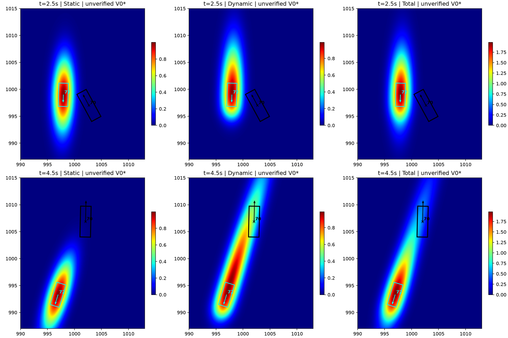
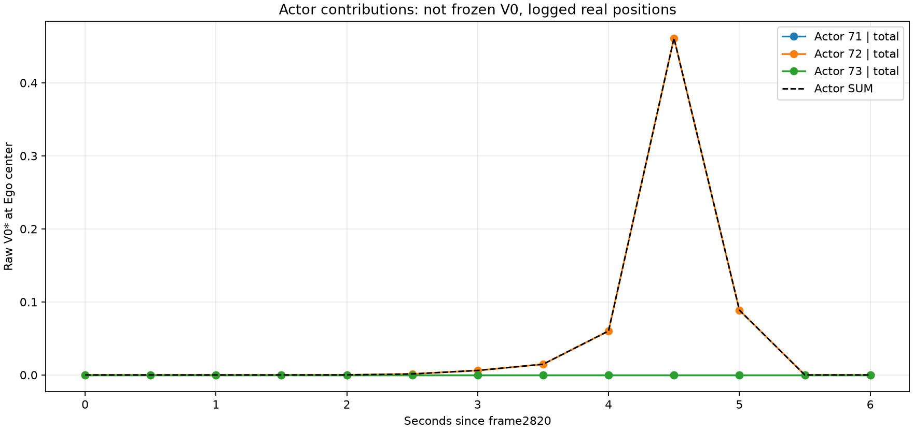
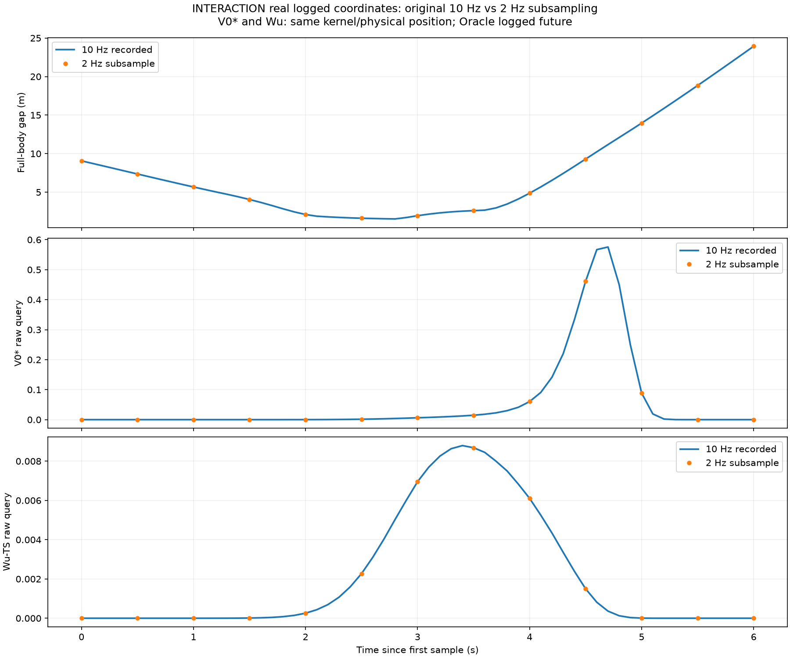
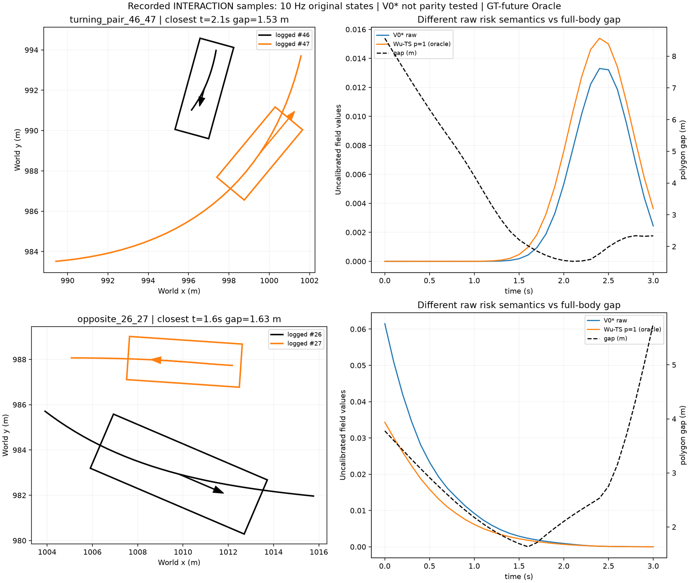
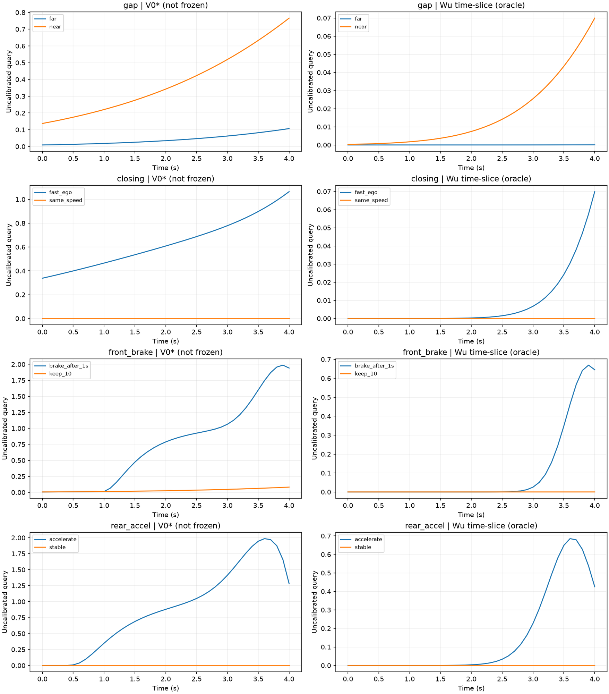
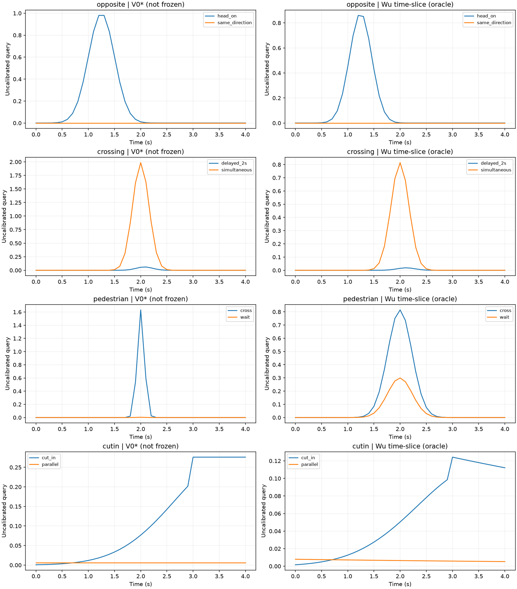
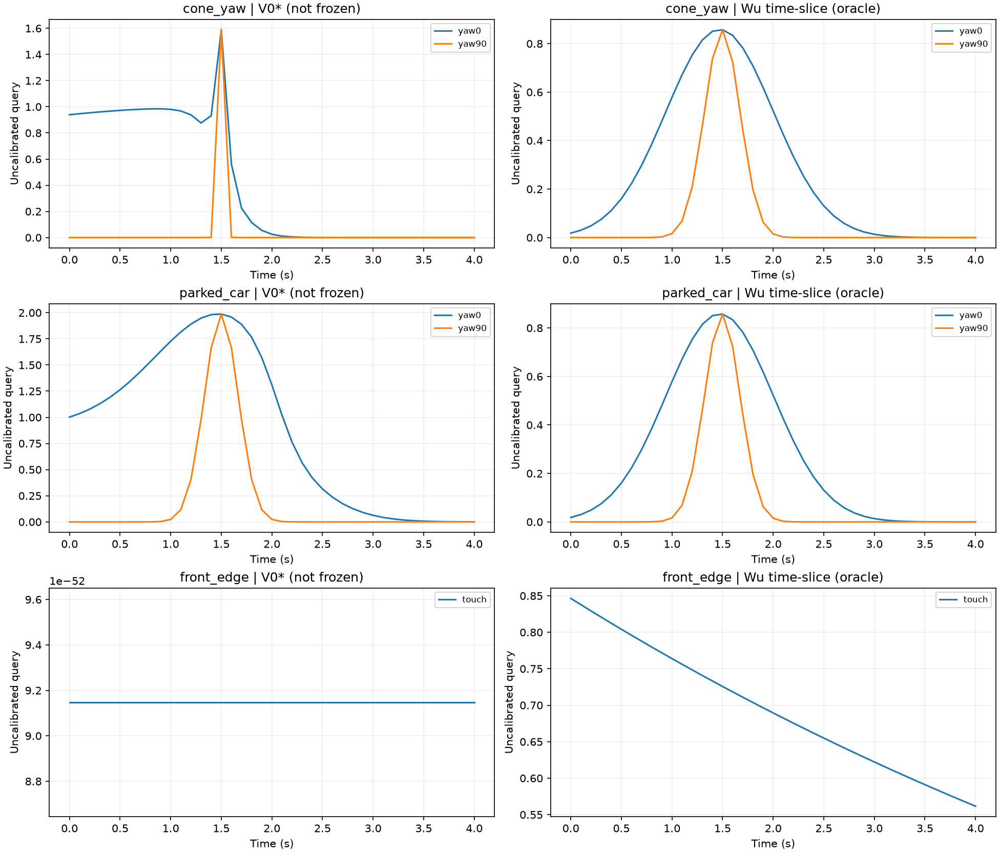
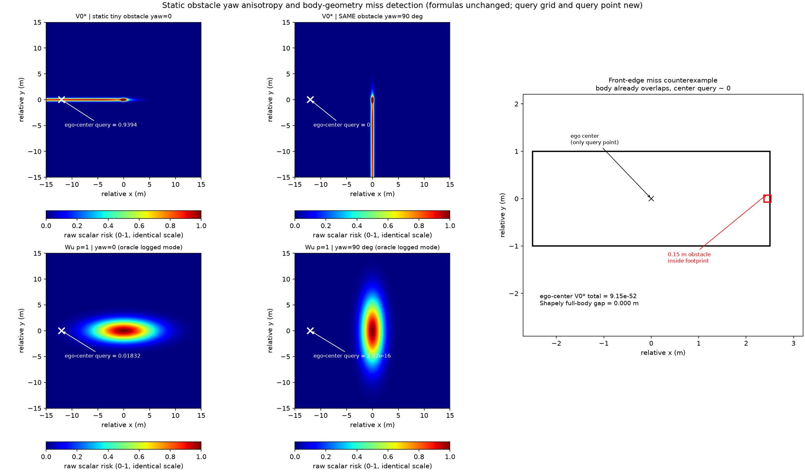
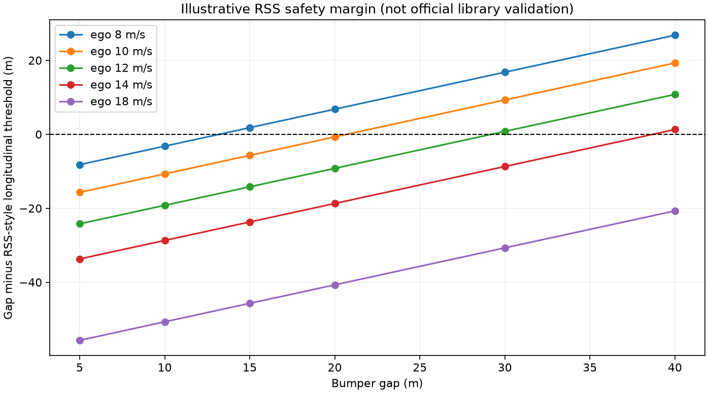

# R2 轨迹风险图件索引（GitHub 可直接浏览）

本文件是第二批实验 `experiments/trajectory_risk_pilot_r2_20261013/` 的**视觉证据入口**。所有图片以相对路径内嵌，在 GitHub 文件页面即可逐张查看，无需下载 ZIP。

> ## 三条必须先读的免责声明
>
> 1. **`V0*` 未通过冻结 V0 源码一致性认证。** 冻结文件 `mcts_planner/risk_field.py`
>    （交接记录 SHA256 `e7ba619c...66ac157`）在本执行环境不存在，仓库树内也未找到。
>    因此本目录全部 `V0*` 数值都是**交接公式的手工端口**，绝不可当作已复现的 Gaussian V0，
>    也不得宣称与 V0 误差为 0。
> 2. **Wu 使用单模态真实记录未来，是离线 Oracle，不是部署预测器。** Wu 曲线的未来位置
>    直接取自数据集已记录的真实轨迹（`p=1`），部署时不可获得；本轮不涉及 TRTP、多模态权重
>    或预测精度。
> 3. **原始风险值是不可比较的无量纲量。** `V0*` 与 `Wu` 的纵轴均为未经标定的 field 查询值，
>    两者数值不可跨模型比大小；`geometry gap (m)` 是独立的物理量，单独画在右轴或单独一栏。

图件的比例、车身矩形、速度箭头、时间标注与色标均已逐张目视核对；`figures/` 目录下的 PNG
与本文件、`index.html` 由同一次运行产出。

复现命令（需 `numpy pandas matplotlib shapely`，输出目录会自动建立）：

```bash
cd experiments/trajectory_risk_pilot_r2_20261013
python run_all.py
```

---

## 1. 全局缩略总览



| 项目 | 内容 |
|---|---|
| 场景 | 本目录全部 9 张图件的缩略接触表 |
| 真实 / 合成 | 混合（每格见对应小节） |
| 车辆 ID | 见各格 |
| 时间 | 见各格 |
| 模型 | `V0*` 手工端口 + Wu Eq7-9 单模态 + Shapely 同步车身几何 |
| 预测输入协议 | 真实记录轨迹（离线） / 解析构造（合成） |
| 需人工判断 | 先由本表判断哪一格值得细看，再进入下面各节 |

---

## 2. Actor 72 异常：t=2.5s 与 t=4.5s 的 Static / Dynamic / Total



| 项目 | 内容 |
|---|---|
| 场景 | INTERACTION EP0 路口真实记录，Ego #70 与 Actor #71/72/73 |
| 真实 / 合成 | **真实**（原始 0.1s 帧 2820–2880 的每第 5 帧） |
| 车辆 ID | Ego 70（黑）、71（白）、72（青）、73（品红） |
| 时间 | 上排 t=2.5s（帧 2845），下排 t=4.5s（帧 2865） |
| 模型 | `V0*`（Static / Dynamic / Total 三列，列内上下共用同一色标） |
| 预测输入协议 | 查询点为 **Ego 中心**，非后轴；Actor 使用记录航向；速度用**标量速率**而非纵向投影 |
| 原始风险值含义 | 无标度 scalar，仅可与同列同色标比较 |
| 已发现异常 | t=2.5s 最近车身间隙 1.621 m，Actor72 总分仅 0.00138；t=4.5s 车身间隙扩大到 **9.297 m**、径向距离变化率 **+9.104 m/s（正在远离）**，Actor72 总分却升至 **0.46131**（其中 Dynamic 0.45613，占 98.9%）。Actor71/73 在 t=4.5s 的贡献约 `1e-94` 与 `1e-87`，**不是多 Actor 叠加**。 |
| 数学链 | 局部横向坐标仅剩 0.940 m（σ_y=1.791 m）；动态纵向尺度 σ_v=6·|v_e−v_a|+0.001=**20.281 m** 把 −14.474 m 的局部纵向坐标仍置于扩展范围内；方向门控 = **0.999999989**，故 `dynamic≈0.456`。 |
| 需人工判断 | 「已远离但持续高速」产生的连续高分，应视为合理的**主观关注区域**，还是与即时碰撞危险语义相悖的**反直觉响应**？此项属于感知/任务语义验收，不是绘图或聚合错误。 |

---

## 3. Actor 71/72/73 逐时风险分量曲线



| 项目 | 内容 |
|---|---|
| 场景 | 同上，0.5s 采样 13 帧的逐 Actor 分解 |
| 真实 / 合成 | **真实** |
| 车辆 ID | 71 / 72 / 73 各自 `total`，另有 `Actor SUM` |
| 时间 | 横轴为距帧 2820 的秒数（0–6s） |
| 模型 | `V0*`（Ego 中心查询，未冻结） |
| 预测输入协议 | 记录位置、记录航向、标量速率 |
| 原始风险值含义 | 未标定 raw 值，非概率 |
| 已发现异常 | 三条曲线中 Actor72 在 4.5s 处独高，峰形与几何间隙不同步 |
| 需人工判断 | 单 Actor 峰值是否应驱动规划「减速/让行」，还是应当被速度方向门控抑制 |

---

## 4. 采样率对照：原始 10Hz 与 2Hz 抽稀



| 项目 | 内容 |
|---|---|
| 场景 | 同一条真实记录序列，按 0.1s 全帧与每 5 帧抽稀 |
| 真实 / 合成 | **真实**（同一坐标，只是采样点不同） |
| 车辆 ID | 70 / 71 / 72 / 73 |
| 时间 | 0–6s，三栏共享横轴 |
| 模型 | 上：Shapely 全车身间隙；中：`V0*`；下：Wu 时间分层 |
| 预测输入协议 | 0.5s 抽稀与 R1 旧样本逐点对齐，**最大绝对误差 < 1e-15**（仅证明公式与实现一致，不替代冻结 V0 校验） |
| 原始风险值含义 | 每栏为各自 raw 查询值 / 米 |
| 已发现异常 | 0.5s 采样错过真正的离散最近帧：最小车身间隙由 1.6210 m@2.5s 变为 **1.5324 m@2.8s**；`V0*` 峰值由 0.46131@4.5s 变为 **0.57564@4.7s**（旧采样低估约 19.9%） |
| 需人工判断 | 用 0.5s 采样做的任何「峰值时刻」结论都应重新核对 |

---

## 5. 另外两组真实运动结构（转向相遇 / 异向交叉）



| 项目 | 内容 |
|---|---|
| 场景 | 上：`turning_pair_46_47`；下：`opposite_26_27` |
| 真实 / 合成 | **真实**（帧 1780–1810 与 980–1010） |
| 车辆 ID | 46/47 与 26/27 |
| 时间 | 各自 0–3.0s，最近间隙时刻 2.1s / 1.6s |
| 模型 | 左：Shapely 车身 + 真实速度矢量；右：`V0*` 与 Wu（右轴为 gap） |
| 预测输入协议 | 记录状态；Wu 为该记录的离线未来（Oracle） |
| 原始风险值含义 | 左右两轴量纲不同，不可相加 |
| 已发现异常 | 46/47：最小间隙 1.5318 m，`V0*` 峰 0.01330@2.4s，Wu 峰 0.01539@2.4s。26/27：最小间隙 1.6326 m@1.6s，但 `V0*` 从 t=0 起就**单调下降**，峰值 0.06149 出现在 t=0 —— 与最小几何间隙**不单调**相关 |
| 需人工判断 | 「越接近反而分数越低/越高」是否由方向门控与局部姿态造成；这是否可接受 |
| 补充 | 0.01s 线性插值复核：三点最小间隙分别为 1.5324 / 1.5283 / 1.6296 m，**均未发现插值中间接触**（属于假设内数值验证，不是更高频真实标注） |

---

## 6. 受控合成对照（11 类变化，物理量严格分列）

### 6.1 页 1：车距 / 闭合速度 / 前车急刹 / 后车加速



| 项目 | 内容 |
|---|---|
| 场景 | `gap`、`closing`、`front_brake`、`rear_accel` 各两个变体 |
| 真实 / 合成 | **合成**（解析构造的 Oracle 未来，无地图、无人工标签） |
| 车辆 ID | 无（匿名 Ego/Actor） |
| 时间 | 0–4.0s，步长 0.1s |
| 模型 | 左列 `V0*`（未冻结），右列 Wu 时间分层（Oracle） |
| 预测输入协议 | 同一位置、同一时刻、同一长宽输入给两种方法 |
| 原始风险值含义 | 未标定查询值 |
| 已发现异常 | 前车 1s 后以 −5 m/s² 制动时，命名 Ego 定速轨迹发生碰撞，两种方法峰值同时上升；后车 3 m/s² 加速同样进入碰撞。**急刹/加速都是构造出来的 Oracle，现网预测器无法预知** |
| 需人工判断 | 模型对「未来条件」的响应是否可接受为诊断用途 |

### 6.2 页 2：对向 / 路口错时 / 行人停等 / Cut-in



| 项目 | 内容 |
|---|---|
| 场景 | `opposite`、`crossing`、`pedestrian`、`cutin` |
| 真实 / 合成 | **合成** |
| 时间 | 0–4.0s |
| 模型 | 左 `V0*`，右 Wu |
| 已发现异常 | 同模长对向运动：两侧标量速率都是 10 m/s，真实闭合速度 20 m/s，但 `V0*` 的 `|Δspeed|` = 0 —— **标量速率差不代表相对运动**。路口错时 2s 的路径，Wu 仍给出非零连续风险 |
| 需人工判断 | 标量速率口径是否需要改为带符号纵向/径向投影 |

### 6.3 页 3：静止锥桶 yaw / 停车汽车 yaw / Ego 前缘小物体



| 项目 | 内容 |
|---|---|
| 场景 | `cone_yaw`、`parked_car`、`front_edge` |
| 真实 / 合成 | **合成** |
| 时间 | 0–4.0s；Ego 从 x=−12 m 驶向 x=0 的障碍物 |
| 模型 | 左 `V0*`，右 Wu |
| 已发现异常（关键） | **锥桶 yaw=0 时 Wu 初始风险 0.01832；yaw=90° 时 ≈ 2.32e-16（即 ≈0）**，但两种 yaw 下 Wu 的整段峰值**完全相同，都是 0.857375**。原因：Ego 恰好经过障碍物中心时与 yaw 无关，所以只看 Peak 会**掩盖 yaw 各向异性**。`V0*` 同样敏感：yaw=0 时 0.9394，yaw=90° 时 0.0 |
| 已发现异常（漏检） | `front_edge`：Ego 5×2 m 车身与 0.15 m 小物体**已经几何重叠（gap = 0.000 m）**，但 Ego 中心点的 `V0*` 仅 **9.15e-52**，Wu 仍有 0.846。中心点单点查询对前缘小物体**基本失明** |
| 需人工判断 | ①静止小型障碍物的风险是否应当与 yaw 无关；②中心点查询是否需要改为多查询点/车身包络；③停车汽车旋转会真实改变矩形占用，**不能**要求其几何风险 yaw 不变，两者须区别对待 |

---

## 7. 静止障碍 yaw 各向异性与车身几何漏检（专用二维场图）



| 项目 | 内容 |
|---|---|
| 场景 | 二维风险场：同一物理静止小障碍物（0.4×0.3 m）在 yaw=0 与 yaw=90° 下的场型；右侧为 Ego 前缘小物体漏检反例 |
| 真实 / 合成 | **合成**；查询点与障碍尺寸**与 `controlled_physics.py` 的 `cone_yaw` t=0、`front_edge` 完全一致**，可直接与 `results/controlled_summary.csv` 对读 |
| 车辆 ID | 无（Ego 位于 (−12, 0)，障碍物位于原点） |
| 时间 | 锥桶：`controlled_physics` 的 t=0 单帧；右侧：静态几何 |
| 模型 | 上排 `V0*`；下排 Wu Eq7-9 `p=1`（离线 Oracle） |
| 预测输入协议 | 4 个面板共用 0–1 色标；Ego 中心单点查询 |
| 原始风险值含义 | 未标定；同一物理障碍物换 yaw 后场型旋转 |
| 已发现异常（数值，与 CSV 逐位一致） | `V0*` @查询点：yaw0 = **0.9394114821799693**，yaw90 = **0.0**。Wu @查询点：yaw0 = **0.01831563888873418**，yaw90 = **2.3195228302435696e-16**。右侧 Ego 中心 `V0*` = **9.147454665092134e-52**，Shapely 全车身 gap = **0.000 m** |
| 需人工判断 | ①Wu 用 Actor 航向构造各向异性 Gaussian，对**静止小型**物体仍对 yaw 极度敏感，是否合理；②中心点查询是否应改为车身几何判据 |

---

## 8. 纵向 RSS-style 安全裕度（仅一维同车道）



| 项目 | 内容 |
|---|---|
| 场景 | 同车道 rear-Ego / front-Actor，反应时间 1 s、反应期加速度上限 2 m/s²、Ego 保证制动 4 m/s²、前车最大制动 6 m/s² |
| 真实 / 合成 | **解析构造** |
| 时间 | 稳态裕度，非时序 |
| 模型 | 解析 RSS-style 长度公式（**非官方库实现**） |
| 原始风险值含义 | 纵轴 = 实际间距 − 阈值（米），负值即裕度不足 |
| 已发现异常 | 前车 10 m/s 时，Ego 同速 10 m/s 需约 **20.67 m**，Ego 14 m/s 需约 **38.67 m** —— 即使名义未来无碰撞，反应期与制动约束仍可能造成裕度不足 |
| 需人工判断 | 是否把该量作为选轨的独立安全闸门；**不适用于横向/路口** |

---

## 9. 完整性校验

- `SHA256SUMS.txt`：本目录全部图件、`data/*.csv`、`results/*` 与脚本的 SHA256 清单（36 条）。
- 关键输入与图件的对应关系可在 `results/` 下的 CSV/JSON 中逐项复核。
- 本地 HTML 浏览器：同目录 `index.html`（GitHub 不会执行 HTML，本文件即为等价的可浏览索引）。
